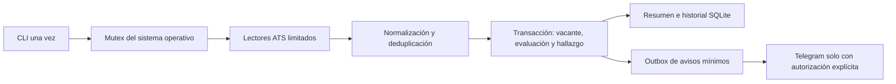

# Ejecución única, recuperación y monitoreo — Fase 5

Base comprobada: PR #9 integrado en `main` (`a30d036`), CI 71 satisfactorio en
Ubuntu/Windows y Python 3.10/3.12/3.13. Esta entrega no despliega producción.

## Preparación y comandos

Usar Python 3.10+ instalado con `pip install -e .` y un directorio privado local
fuera del checkout. No usar el launcher de escritorio con autoactualización para
operación desatendida. Runtime sin dependencias adicionales.

```bash
export JOB_SEARCH_ASSISTANT_HOME=/ruta/privada/jobsearch
export DRY_RUN=true
export AUTO_SUBMIT=false
jobsearch init --language es
# Revisar/importar el perfil JSON real; no inferir hechos para mejorar el score.
jobsearch profile import /ruta/privada/profile.json
jobsearch automation run --config /ruta/privada/sources.json --budget-seconds 120
jobsearch automation runs --limit 20
jobsearch automation show ID_DE_EJECUCION
jobsearch automation health --max-age-seconds 86400
```

En PowerShell definir las mismas variables con `$env:NOMBRE = "valor"`.
Se conserva `sources.json` de [Fase 2](JOB_SOURCES.md), independiente de los perfiles
JSON. Solo tableros explícitamente habilitados hacen GET; sin `--config` no hay
solicitudes. No se incorpora otra fuente, scraping o navegador. Un run vacío
correcto no demuestra conectividad con proveedores.

El perfil debe existir, ser JSON regular acotado y válido. El comando nuevo
rechaza entradas corruptas sin fallback silencioso ni sobrescritura. No cambia
la recuperación histórica del perfil en la GUI/CLI anteriores. Configuración
de fuentes y perfil rechazan archivos no regulares; no se abre un FIFO esperando
un escritor. No guardar el home de automatización dentro del checkout.

El presupuesto acepta **0.05–86400 segundos**, default **120**. Incluye inicio,
esperas, HTTP, procesamiento y drenaje opcional; el cierre transaccional y limpieza
pueden añadir un margen corto. No es una garantía de tiempo real frente a un disco
bloqueado o una pausa del sistema operativo. SQLite de este comando limita espera
por writer a 100 ms o al presupuesto restante; backups de migración comprueban
cancelación por páginas. El resto de APIs conserva sus defaults.

## Arquitectura y persistencia



`automation.py` conecta `DiscoveryEngine`, `SafeHttpClient` y matching existentes.
Cada página valida/normaliza primero y confirma cada observación antes de pedir
la página siguiente. Una respuesta parcial o fallo de otro proveedor conserva
lo ya confirmado. No declarar retirada/cerrada una vacante porque no aparezca en
un resultado parcial. No se crea, adapta, aprueba ni envía ninguna candidatura.

Esquema SQLite **4**, aditivo desde 1/2/3, con backup consistente previo de la
versión original y transacción. Tablas:

| Tabla | Contenido |
| --- | --- |
| `automation_runs` | Inicio/fin, estado, huellas de configuración/perfil y reportes redactados |
| `automation_items` | Vacante/evaluación exactas y clasificación de cambio por run |
| `automation_observations` | Última huella semántica/perfil/algoritmo y evaluación reutilizable |
| `automation_http_state` | Fallos y deadlines UTC por proveedor |
| `automation_source_health` | Racha de runs con problemas, episodio y fechas de éxito/fallo |
| `automation_notification_health` | Último drenaje significativo y métricas de entrega durables |
| `notification_outbox` | Eventos mínimos únicos y estado/intentos de entrega |
| `notification_delivery_state` | Cooldown compartido de Telegram |

La misma identidad proveedor/tablero/ID conserva el ID SQLite. Un cambio únicamente
en `retrieved_at` reutiliza la evaluación; cambios de contenido/evidencia/perfil o
algoritmo conservan snapshots nuevos. Los hallazgos distinguen `new`, `changed`,
`reevaluated`, `unchanged`; el matching mantiene sus seis clasificaciones y la
elegibilidad desconocida. Cambios de vacante usan el mismo guard transaccional
de Fase 4 y revocan aprobaciones existentes; un refresh de fecha no las revoca.
No modifica notas/estados del tracker ni reinterpreta evaluaciones históricas.

## Bloqueo, fallos y reinicio

`automation.lock` usa `flock` en POSIX y `msvcrt.locking` en Windows. No borrar ni
reemplazar ese archivo para desbloquear: el kernel libera la exclusión al morir
el proceso. No hay TTL ni PID que permita robar un lock todavía activo. Se
rechazan symlinks/archivos no regulares. Bajo ese lock se migran datos, recuperan
runs `running` abandonados como `interrupted` y se comienza un ID nuevo. Los
commits anteriores permanecen; reejecutar reutiliza vacantes/evaluaciones.

SIGINT/SIGTERM solicitan cancelación. El HTTP real vive en un subproceso spawn
terminable; un watchdog limita cada solicitud y elimina el worker si muere su
padre. Así una respuesta que avance lentamente no elude el timeout total de la
solicitud ni el presupuesto del run. La biblioteca anterior sin `control` mantiene
su contrato. Transportes inyectados síncronos son para pruebas; deben envolverse
en `BoundedTransport` si pueden bloquear.

Cuotas de solicitudes/reintentos siguen siendo por proveedor/ejecución, compartidas
entre tableros/páginas. Se persisten cooldowns, intervalo mínimo, backoff y fallos
consecutivos entre invocaciones. Una reserva durable previa al GET retrasa un
reinicio aunque el proceso muera antes de recibir respuesta. `Retry-After` no se
acorta: si no cabe, se pospone la fuente. Un éxito reinicia la racha; pausas evitan
consultas fallidas indefinidas. `automation_source_health.failures` cuenta runs
con problemas; el estado HTTP cuenta errores de intentos, conceptos distintos.

La exclusión es local a este home/base. No coordina clones, `discover` independiente,
otros hosts o sistemas NFS/FAT con semántica incompatible. No ejecutar en paralelo
comandos manuales para eludir cuotas. Los escritores manuales SQLite siguen
coordinados por transacciones, y pueden hacer que un run falle por base ocupada.

## Logs, health y códigos

Stdout contiene un resumen JSON. Stderr contiene eventos JSON (`run_started`,
`observation`, `source_finished`, `run_finished`, `automation_error`) con códigos,
IDs internos y contadores. Nunca se imprimen perfil, CV, título/empresa/URL,
contenido remoto, token, chat o excepciones externas. No hay telemetría ni servidor.
`--language es/en` controla los avisos; los campos/códigos JSON son estables.

`health` es de solo lectura: no crea/migra SQLite. Comprueba integridad rápida,
esquema, último run/frescura, estado por proveedor, pausas, cola y estados ambiguos.
La salud del último run no acredita conectividad cuando no había fuentes habilitadas;
revisar también `sources`. Un fallo o entrega ambigua de un drenaje autorizado
produce salida 1 y degrada health; se conservan las métricas por run en `runs/show`.
Un run posterior sin notificar o con cero intentos diferidos no borra ese diagnóstico.
Un drenaje significativo posterior permite observar recuperación. La búsqueda
conserva su estado separado del resultado de entrega; cancelación/deadline durante
el drenaje conservan salidas 130/4. Revisar también inciertos históricos de la cola.
Los contadores/fechas permiten observar duración, volumen,
rechazos, duplicados, prioridades, información pendiente y recuperación sin servicios
de métricas externos. `runs/show` no exportan snapshots privados.

| Salida | Significado para invocación futura desde systemd |
| --- | --- |
| 0 | Run completo; health correcto; o lectura correcta |
| 1 | Resultados parciales, health no saludable o fallo operativo de notificación |
| 2 | Configuración/política/almacenamiento inválidos; revisar código JSON |
| 3 | Otra ejecución tiene el lock; no se inicia otra búsqueda |
| 4 | Presupuesto del run agotado |
| 130 | Interrupción solicitada |

Fuentes pausadas o parciales dan salida 1 con resultados válidos conservados.
La cola diferida por rate limit puede permanecer pendiente; no obliga a repetir
todo el run inmediatamente. No se agrega bucle infinito ni scheduler residente.

## Telegram opcional y autorización

Está **deshabilitado por defecto**. No se envió ningún mensaje real durante esta
entrega. Solo se realizaron pruebas con respuestas sintéticas.

Para una futura activación autorizada, definir en entorno o archivo privado del
gestor de procesos (fuera de Git, permisos restrictivos):

- `JOBSEARCH_TELEGRAM_ENABLED=true`
- `JOBSEARCH_TELEGRAM_TOKEN`: token del bot, nunca argumento CLI ni log.
- `JOBSEARCH_TELEGRAM_CHAT_ID`: chat numérico autorizado.

Después invocar explícitamente `jobsearch automation run --config /ruta/privada/sources.json --notify`.
Sin `--notify` no se consulta el token ni se drena la cola; sin enabled/token/chat
no se llama al transporte. Un aviso jamás aprueba ni envía una candidatura.
El programa no recibe órdenes de Telegram ni expone webhooks.

Solo se envían etiquetas estáticas ES/EN, cantidad e IDs internos: prioridad alta,
borrador existente pendiente de revisión, elegibilidad pendiente, error de fuente,
recuperación y resumen. No se envían títulos, empresas o enlaces que pudieran
contener datos sensibles. El detalle se consulta localmente por ID.

Outbox con claves únicas persistentes: una misma evaluación/candidatura-revisión
no duplica avisos; un error repetido comparte episodio hasta recuperarse. Cada run
tiene su propio resumen. Un lock de entrega independiente protege dos dispatchers.
Intento confirmado antes de POST; éxito confirmado queda `sent`. Timeout, crash,
5xx o respuesta ambigua quedan `uncertain` y **no se reenvían automáticamente**.
Esto prefiere omitir un aviso dudoso a duplicarlo; no promete exactly-once remoto.
Revisar el chat/SQLite manualmente y crear un evento nuevo autorizado si procede;
no resetear estados para forzar un replay.

Ante 429 inequívoco se persiste la mayor espera entre `parameters.retry_after` y
`Retry-After`; no se espera más allá del presupuesto. Otros rechazos definitivos
terminan el evento. Defaults: máximo 10 intentos por drenaje, 3 intentos por evento,
intervalo 3.1 s por chat desde el cierre de la entrega anterior, 30 s de presupuesto de notificación dentro del total,
timeout 10 s y respuesta 64 KiB. Los límites son configurables por `TelegramConfig`
en API; la CLI solo expone activación y presupuesto total para reducir superficie.
No paid broadcasts, contenido activo ni redirects; TLS/proxy normales.

Referencias oficiales consultadas: [sendMessage/Bot API](https://core.telegram.org/bots/api#sendmessage)
y [límites de bots](https://core.telegram.org/bots/faq#my-bot-is-hitting-limits-how-do-i-avoid-this).
La FAQ aconseja 1/s por chat y 20/min por grupo; el intervalo elegido es conservador.
No se probó conectividad a Telegram desde Cloud. Los avisos pendientes pueden
acumularse al estar desactivado: revisar la cola antes de una primera activación;
el límite de drenaje evita enviarlos todos en una sola ejecución.

## Claude y revisión independiente

Workflow oficial preparado, manual, desactivado por variable ausente y protegido
por environment/revisión humana. No hubo credenciales configuradas para Claude en
Cloud ni invocación/revisión real de Claude. [CLAUDE_REVIEW](CLAUDE_REVIEW.md) detalla
acción fijada, permisos de lectura, selección exacta, diff acotado no ejecutado,
herramientas denegadas, exposición en logs del proveedor y activación pendiente.
Las revisiones de desarrollo por otros agentes no se presentan como Claude.

## Backup, restauración y rollback

1. Detener ejecuciones y preservar el conjunto privado: SQLite, perfil/ajustes,
   sources JSON y `resumes/`. Nunca copiar solo SQLite si hay WAL activo.
2. `jobsearch database backup --source /datos/applications.sqlite3 --output /backup/nuevo.sqlite3`.
3. `jobsearch database restore --source /backup/nuevo.sqlite3 --output /recuperacion/nuevo.sqlite3`.
4. La restauración de esquema 4 conserva historial, revoca aprobaciones de Fase 4
   y marca avisos `pending/sending` como `uncertain` para no reanimar efectos remotos.
   Una base 3 restaurada permanece 3 y revoca sus permisos; migrará al abrirse con
   el código nuevo. Nunca editar el marcador a mano.
5. Para rollback de código a Fase 4, restaurar el backup **previo a migración**
   `*.schema3-*.bak` en destino nuevo y usar el commit integrado de Fase 4 en checkout
   separado. El procedimiento de restore de esta versión revoca capacidades aun
   en backups 3. Conservar la base 4 para recuperar cambios posteriores manualmente.

Los locks abandonados no requieren borrar archivos. No hay coordinación global
de consumo de aprobaciones/avisos entre copias independientes. Backups/snapshots
incluyen datos privados en claro; revisar permisos POSIX y ACL Windows.

## Checklist manual y requisitos pendientes para PizzaLab

- [ ] Revisar perfil, fuentes habilitadas, términos y acceso de red autorizado.
- [ ] Ejecutar una vez sin Telegram; revisar summary, health y matching desconocido.
- [ ] Interrumpir/reanudar en datos de prueba y restaurar SQLite+CV a destino nuevo.
- [ ] Revisar pendientes/ambiguos antes de autorizar Telegram y confirmar chat seguro.
- [ ] Si se autoriza Claude, configurar environment/coste y revisar evidencia SHA.
- [ ] Verificar GUI visual y documentos Office/ATS con datos privados locales.
- [ ] Antes de PizzaLab: integrar este PR y autorizar Fase 6, acceso al LXC Debian,
      usuario sin privilegios, versión fijada, venv sin GUI, ACL, egress ATS/Telegram,
      presupuesto/intervalo del timer, política de exit codes, retención de logs,
      backups/restore, recursos y rollback. No se crean ni instalan unidades ahora.

Codex Cloud sigue siendo un entorno de desarrollo, no alojamiento permanente.
Los resultados finales de unittest/pytest, revisión y seis jobs CI del commit
publicado se registran en el PR; las pruebas de CI no dependen de servicios externos.

Verificación local final: Python 3.12, **372 unittest** y
**372 pytest +604 subtests**, aprobados. `pip check` y compilación aprobados.
Ruff E9/F no detecta errores nuevos; existe F401 histórico en
`scripts/auto_update.py`, fuera de alcance y sin modificar.

La revisión independiente de `45d0461` detectó dos Important: falsos éxitos tras
fallos de Telegram y pérdida de Retry-After al cancelar en el límite de respuesta.
El autor los corrigió con regresiones RED→GREEN y suite completa; no se atribuye
al revisor una segunda inspección del código posterior. La respuesta completada
se entrega desde IPC y guarda sus metadatos antes de cancelar; no se procesa otro
JSON, matching o reintento después del límite. Un Retry-After jamás recibido por
el proceso sigue siendo desconocido.

La primera matriz CI (72) detectó en Windows un fixture SQLite sin cerrar, una
carrera al publicar el PID del worker y un intervalo Telegram acortado por el
tiempo de preparación del transporte. Se cerró explícitamente la conexión y se
publicó el marcador atómicamente; el intervalo ahora se reserva también después
de terminar la entrega. Una prueba de reloj simulado reprodujo 2.9 s frente a los
3.1 s configurados y verificó la corrección. Se conservan las aserciones anteriores,
sin skips nuevos. La matriz del encabezado final se confirma en el PR #10.

Los tests no certifican un límite duro de VM SQL o de finalización para bases de
tamaño arbitrario: el recorrido de borradores/historial y disco pueden añadir
tiempo. Medir ese volumen y presupuesto en el host objetivo antes de programarlo;
no se afirma validación de producción, Windows local, GUI visual o runtime Claude.
